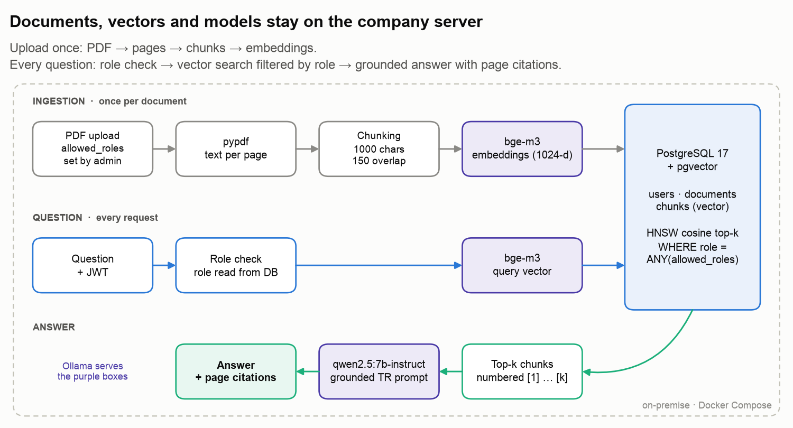
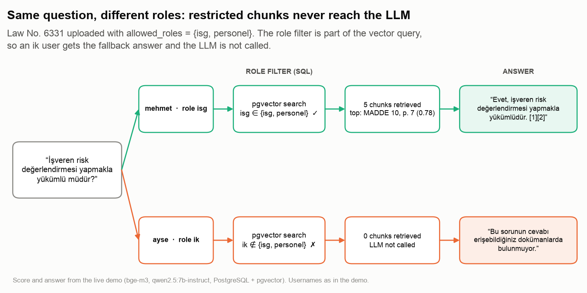
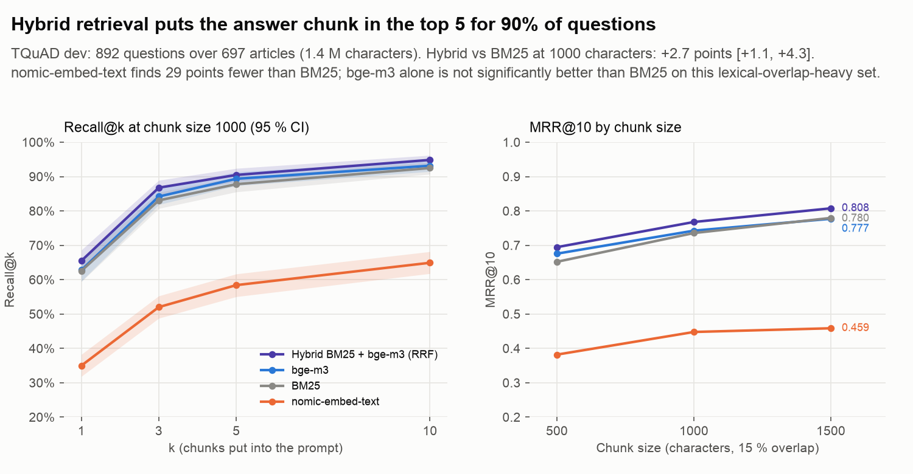
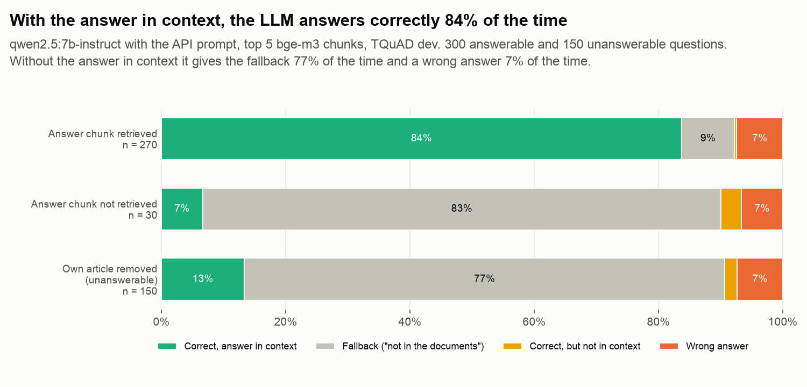
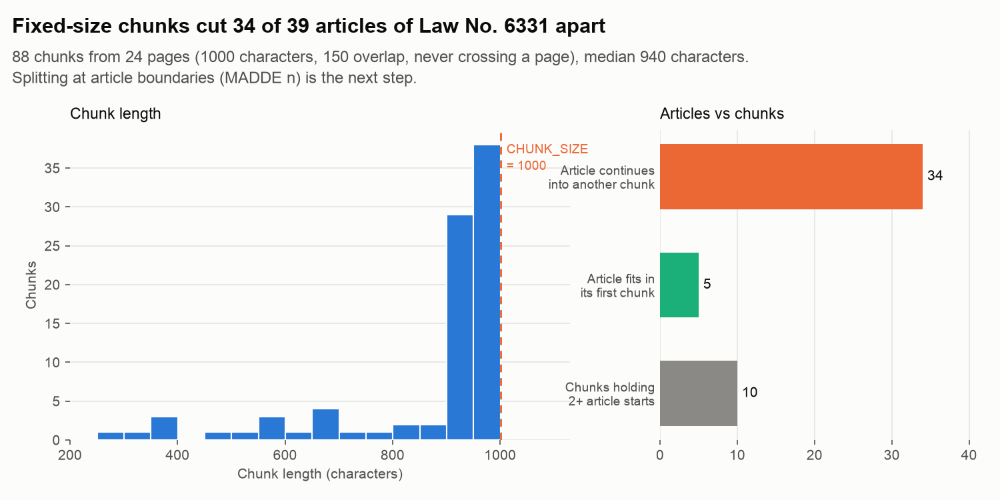

# On-Premise RAG Document Assistant System

## 1. Introduction

This project implements a retrieval-augmented generation (RAG) assistant, a Generative AI system in which an open-weight large language model (LLM) answers Turkish questions over internal PDF documents (occupational health and safety law, work instructions, procedures) and cites the document and page for every answer. Everything runs on the company's own server: Ollama serves the LLM and the embedding model, PostgreSQL with pgvector is the vector database, and no document or question leaves the network. Each user only gets answers from the documents their role is allowed to read.



| | |
|---|---|
| Retrieval (TQuAD dev, 892 questions, 697 articles, exact answer-span relevance) | `bge-m3`: **Recall@5 0.893**, MRR@10 0.743 · hybrid BM25 + `bge-m3`: **Recall@5 0.905** [95 % CI 0.885–0.924], significantly above BM25 (+2.7 points) |
| Answers (`qwen2.5:7b-instruct`, 300 answerable + 150 unanswerable TQuAD questions) | With the answer chunk in context: **83.7 % correct** [78.9–88.1] (85.6 % after reading the failures by hand). Without it: the fallback answer **77.3 %** of the time, a wrong answer 7.3 % |
| Embedding model choice | `nomic-embed-text` finds the answer chunk **29 points less often** than BM25 on Turkish; `bge-m3` is the default for this reason |
| Live demo (PostgreSQL + pgvector, Ollama) | Article 10 (risk assessment, p. 7) ranked first and the answer cited it; the same question from a user without access returned the fallback answer and never reached the LLM |
| Chunking | Fixed-size chunks split **34 of 39** articles of Law No. 6331 across two or more chunks (Section 10.4) |

**Core Features:**
- Fully on-premise LLM inference: Ollama serves `qwen2.5:7b-instruct` (open-weight, 4-bit Q4_K_M quantization) for answers and `bge-m3` for embeddings; nothing is sent to external APIs
- Vector database: PostgreSQL + pgvector with an HNSW cosine index for semantic search; the role filter runs inside the vector query
- Role-based access control (RBAC): every document stores the roles allowed to read it; chunks from other documents never reach the LLM
- JWT authentication, bcrypt password hashing, role read from the database on every request
- Page-aware chunking with overlap, so every answer can cite an exact page
- Prompt engineering for grounded answers: the Turkish system prompt answers only from the retrieved context, with `[n]` citations and an explicit "not in the documents" fallback to limit hallucinations
- REST API (FastAPI) with Swagger UI, plus a command-line client
- Docker Compose deployment for Mac (native Ollama with Metal GPU) and Linux servers (Ollama in a container, optional NVIDIA GPU)
- Retrieval evaluation on TQuAD: BM25, two embedding models and a hybrid search (BM25 + `bge-m3` with Reciprocal Rank Fusion), three chunk sizes, bootstrap 95 % CIs and paired comparisons
- LLM answer evaluation on TQuAD: correctness when the answer is in context, fallback rate and wrong (hallucinated) answers when it is not
- Written without LangChain or LlamaIndex: chunking, retrieval, prompting and evaluation are plain Python on SQLAlchemy and httpx
- 29 data-free, database-free unit tests and a GitHub Actions CI

## 2. Methodology / Approach

A document is split, embedded and stored once at upload time. At question time only the question is embedded; the nearest chunks the user may read are put into the prompt, and the LLM writes an answer that cites them.

### 2.1 System Architecture

```
                 JWT                     ┌──────────────────────────────┐
 User ───────────────► FastAPI ─────────►│ Ollama                       │
 (CLI / Swagger)       /auth             │  • bge-m3   (embeddings)     │
                       /documents        │  • qwen2.5:7b-instruct (LLM) │
                       /chat             └──────────────────────────────┘
                          │
                          ▼
                 PostgreSQL 17 + pgvector
                 users · documents (allowed_roles) · chunks (vector(1024), HNSW)
```

| Stage | What it does | Why |
|---|---|---|
| Extraction | `pypdf` text per page, then normalization (hyphenation, whitespace, the broken "ğ" spacing some fonts produce) | Page numbers are kept for citations |
| Chunking | Sentences/lines packed into ~1000-character chunks with 150-character overlap, never crossing a page | Small enough for precise retrieval, large enough to hold a full legal clause |
| Embedding | `bge-m3` through Ollama, batched | Multilingual model, 1024 dimensions; the best single embedding model on Turkish in Section 10.1 |
| Retrieval | Cosine distance on an HNSW index, filtered by `user.role = ANY(allowed_roles)` | The filter is part of the SQL query, not a post-processing step |
| Generation | Retrieved chunks numbered `[1]…[k]` in a Turkish system prompt, temperature 0.1 | Grounded, citable answers; refuses when the context has no answer |

### 2.2 Implementation Strategy

The code is a small installable package (`src/docrag/`) with one module per concern: settings, database models, security, Ollama client, chunking, ingestion, retrieval and the HTTP routes. Chunking is pure Python with its own unit tests; everything that needs PostgreSQL or Ollama sits behind `db.py` and `llm.py`. Settings come from environment variables; `JWT_SECRET` and `ADMIN_PASSWORD` have no defaults, so the service refuses to start with placeholder secrets.

## 3. Mathematical Framework

### 3.1 Cosine Similarity

For a question embedding **q** and a chunk embedding **d**:

$$\text{sim}(\mathbf{q}, \mathbf{d}) = \frac{\mathbf{q} \cdot \mathbf{d}}{\lVert \mathbf{q} \rVert \, \lVert \mathbf{d} \rVert}$$

pgvector's `<=>` operator returns the cosine distance $1 - \text{sim}$; the API reports $\text{sim}$ as the source score.

### 3.2 Approximate Nearest Neighbor Search

The HNSW index (`m = 16`, `ef_construction = 64`) finds the top-k chunks in roughly logarithmic time instead of scanning every vector. With a role filter, a plain HNSW scan can return fewer than k rows; `hnsw.iterative_scan = relaxed_order` (pgvector ≥ 0.8) keeps scanning until k permitted rows are found. On older pgvector the candidate list is widened instead (`hnsw.ef_search = 200`); the version is checked once per process (Section 10.5).

### 3.3 Retrieval Metrics

For $N$ questions where $\text{rank}_i$ is the position of the first relevant chunk:

$$\text{Recall@}k = \frac{1}{N}\sum_{i=1}^{N} \mathbb{1}[\text{rank}_i \le k] \qquad \text{MRR@}10 = \frac{1}{N}\sum_{i=1}^{N} \frac{\mathbb{1}[\text{rank}_i \le 10]}{\text{rank}_i}$$

Recall@k is the share of questions for which the answer chunk is among the k chunks put into the prompt; MRR rewards placing it first.

### 3.4 BM25 and Hybrid Retrieval

BM25 scores a chunk $d$ for a question $q$ by term overlap, with term frequency saturation and length normalization ($k_1 = 1.5$, $b = 0.75$):

$$\text{BM25}(q, d) = \sum_{t \in q} \text{IDF}(t)\,\frac{f(t,d)\,(k_1 + 1)}{f(t,d) + k_1\left(1 - b + b\,\frac{|d|}{\text{avgdl}}\right)}$$

The hybrid retriever fuses the BM25 and `bge-m3` rankings with Reciprocal Rank Fusion, which needs no score calibration between the two:

$$\text{RRF}(d) = \sum_{r \in \{\text{BM25},\,\text{bge-m3}\}} \frac{1}{60 + \text{rank}_r(d)}$$

### 3.5 Confidence Intervals and Paired Comparisons

Every metric gets a 95 % percentile bootstrap CI over questions (2,000 resamples). Two retrievers are compared on the same questions: the per-question difference in hits is bootstrapped, and a difference counts as significant only when its CI excludes zero.

## 4. Dataset

### 4.1 Datasets

| Dataset | Content | Used for |
|---|---|---|
| [Law No. 6331 on Occupational Health and Safety](https://csgb.gov.tr/Media/fldk2co0/6331_isgkanunu_tr.pdf) [1] | 24-page Turkish law (Official Gazette No. 28339, 30 June 2012) | Sample company document |
| [TQuAD](https://github.com/TQuad/turkish-nlp-qa-dataset) [2] | Turkish SQuAD-format QA on science history: 681 train / 72 dev articles, 8,308 / 892 question-answer pairs | Retrieval evaluation |

`python scripts/download_data.py` downloads both into `data/raw/`.

### 4.2 Retrieval Evaluation Protocol

| Choice | Setting | Why |
|---|---|---|
| Queries | All 892 dev questions | Every dev answer is located in its paragraph; none had to be dropped |
| Corpus | 72 dev articles + 625 train articles (1.4 M characters) | The dev articles alone would make retrieval too easy; train articles act as distractors |
| Leakage control | 56 train articles excluded: same title as a dev article or a paragraph identical to one | Otherwise a duplicate of the gold paragraph would be scored as a wrong hit |
| Relevance | A chunk from the question's own article that contains the **whole** answer span at its annotated position | A chunk that cuts the answer in half, or the same words elsewhere, does not count |
| Chunking | The production chunker (`chunking.split_text`), 500 / 1000 / 1500 characters with 15 % overlap | Measures the code that runs in the API |
| Search | Exact cosine over all chunks (no HNSW) | Isolates chunking and embedding quality from index approximation |

Whitespace is collapsed before chunking and every answer offset is mapped through that change; each chunk is then located in its article, so relevance is decided by character spans, not by string matching. With 1000-character chunks every answer lies whole in at least one chunk; with 500 characters, 2 of 892 answers are cut by every chunk.

### 4.3 Answer Evaluation Protocol

The answer evaluation runs the production setup end to end: `bge-m3` retrieves the top 5 chunks (1000 characters, 150 overlap) from the same corpus, and `qwen2.5:7b-instruct` answers with the API's system prompt (`prompt.py` is shared by the API and the evaluation). Two disjoint random samples of dev questions (seed 0) are used:

| Condition | Questions | Context | Expected behavior |
|---|---|---|---|
| Answerable | 300 | Top 5 chunks from the whole corpus | Answer correctly and cite the chunk |
| Unanswerable | 150 | Top 5 chunks after removing every chunk of the question's own article | Give the fallback answer |

Scoring is deterministic. An LLM judge was not used, because the only judge available on premises would be the same 7B model grading its own answers.

| Measure | Definition |
|---|---|
| Exact | The normalized gold answer appears in the answer as a phrase starting on a word boundary. A Turkish suffix may follow its last word, because TQuAD spans often stop inside a word ("Buzgan kasabası" in "Buzgan kasabasında"); after a final digit nothing may follow, so "12" does not match "1200" |
| Token recall | Share of gold answer tokens found in the answer, matching on the first five characters to accept suffixes |
| Correct | Exact, or token recall of at least 0.5 |
| Refused | The answer gives the fallback ("bulunmuyor", "bulunmamaktadır" and similar) |
| Cited / cited gold | The answer has an `[n]` marker / a cited chunk holds the gold answer span |

Each answer gets one outcome. "Correct" requires the gold answer text to appear somewhere in the context, so in the unanswerable condition it means another article happened to contain the same fact. "Correct but not in context" means the model answered from its own memory, which breaks the grounding rule even though the answer is right. "Wrong answer" is everything that is neither correct nor a fallback.

### 4.4 Roles

| Role | Meaning |
|---|---|
| `admin` | Reads every document, uploads and deletes documents, creates users |
| `isg` | Occupational health and safety team |
| `ik` | Human resources |
| `uretim` | Production |
| `personel` | All staff |

The filter is applied inside the SQL vector query, not after retrieval. A user whose role is not in a document's `allowed_roles` gets none of its chunks, and when no chunk is left the API returns the fallback answer without calling the LLM:



## 5. Model

| Component | Model | Notes |
|---|---|---|
| LLM | `qwen2.5:7b-instruct` (Ollama, Q4_K_M, 4.7 GB) | Answers in Turkish and fits on a single workstation GPU or Apple Silicon |
| Embeddings | `bge-m3` (Ollama, 1024-d) | Multilingual dense retrieval; no query/passage prefixes needed. On TQuAD it reaches Recall@5 0.893 vs 0.584 for `nomic-embed-text` (Section 10.1) |

Both are set with `LLM_MODEL` and `EMBED_MODEL`; changing the embedding model also requires `EMBED_DIM` to match and the documents to be re-ingested.

## 6. Requirements

`requirements.txt`

```txt
fastapi>=0.115
uvicorn[standard]>=0.34
sqlalchemy>=2.0.36
psycopg[binary]>=3.2
pgvector>=0.3.6
pydantic-settings>=2.7
pyjwt>=2.10
bcrypt>=4.2
httpx>=0.28
pypdf>=5.1
python-multipart>=0.0.20
```

The same dependencies are declared in `pyproject.toml`; the `dev` extra adds `pytest`, `ruff` and `numpy`, the `eval` extra adds `numpy` for the TQuAD evaluations, and the `figures` extra adds `matplotlib` for `scripts/make_figures.py`. Running the service also needs Docker and [Ollama](https://ollama.com).

## 7. Installation & Configuration

### 7.1 Environment Setup

```bash
# Clone the repository
git clone https://github.com/kemalkilicaslan/On-Premise-RAG-Document-Assistant-System.git
cd On-Premise-RAG-Document-Assistant-System

# Create an environment and install the package
uv venv -p 3.11 && source .venv/bin/activate      # or python -m venv
pip install -e ".[dev]"                           # or: pip install -r requirements.txt

# Download the models
ollama pull qwen2.5:7b-instruct
ollama pull bge-m3
```

### 7.2 Project Structure

```
On-Premise-RAG-Document-Assistant-System/
├── .github/workflows/ci.yml   # ruff + pytest on Python 3.10 and 3.12
├── scripts/
│   ├── download_data.py       # Law No. 6331 PDF and TQuAD
│   └── make_figures.py        # the README figures (retrieval figure from outputs/eval/)
├── sql/
│   └── init.sql               # enables the pgvector extension
├── src/docrag/
│   ├── api.py                 # FastAPI app, lifespan, /health
│   ├── config.py              # settings from environment / .env
│   ├── db.py, models.py       # SQLAlchemy engine, users / documents / chunks tables
│   ├── schemas.py             # request and response models, roles
│   ├── security.py            # bcrypt, JWT, role checks
│   ├── llm.py                 # Ollama embeddings and chat
│   ├── chunking.py            # normalization and page-aware chunking
│   ├── ingest.py              # PDF → pages → chunks → embeddings → database
│   ├── prompt.py              # system prompt, fallback answer, context formatting
│   ├── rag.py                 # role-filtered vector search and answer
│   ├── evaluate.py            # TQuAD retrieval evaluation: BM25, embeddings, hybrid, CIs
│   ├── evaluate_answers.py    # TQuAD answer evaluation: correctness, fallback, wrong answers
│   ├── cli.py                 # command-line client
│   └── routers/               # auth, documents, chat
├── tests/                     # pytest suite (no database or Ollama needed)
├── data/raw/                  # documents and datasets (downloaded, not tracked)
├── data/cache/                # cached embeddings for the evaluation (not tracked)
├── outputs/eval/              # retrieval (summary.json, per_question.csv) and answer results (answers_summary.json, answers.csv)
├── On-Premise-RAG-Document-Assistant-*.png   # the README figures
├── Dockerfile
├── .dockerignore
├── docker-compose.yml
├── docker-compose.gpu.yml     # NVIDIA GPU override for the Linux server
├── .env.example
├── .gitignore
├── Makefile
├── pyproject.toml
├── README.md
├── requirements.txt
└── LICENSE
```

### 7.3 Required Files

- **Documents and datasets:** `python scripts/download_data.py` populates `data/raw/`.
- **Models:** `qwen2.5:7b-instruct` and `bge-m3` pulled into Ollama (on Linux the `ollama-pull` service does this automatically).
- **Secrets:** a `.env` file created from `.env.example`.

### 7.4 Configuration Parameters

`.env` (copied from `.env.example`):

```bash
POSTGRES_USER=rag
POSTGRES_PASSWORD=rag_dev_password   # change on a real server
POSTGRES_DB=rag

OLLAMA_BASE_URL=http://host.docker.internal:11434   # Linux server: http://ollama:11434
LLM_MODEL=qwen2.5:7b-instruct
EMBED_MODEL=bge-m3
EMBED_DIM=1024             # must match the embedding model

JWT_SECRET=                # openssl rand -hex 32 (min. 32 characters, required)
JWT_EXPIRE_MINUTES=60
ADMIN_USERNAME=admin
ADMIN_PASSWORD=            # min. 8 characters, required

CHUNK_SIZE=1000            # characters per chunk
CHUNK_OVERLAP=150          # characters shared by consecutive chunks
TOP_K=5                    # chunks put into the prompt
```

## 8. Usage / How to Run

### 8.1 Start the Service

```bash
cp .env.example .env            # then fill in JWT_SECRET and ADMIN_PASSWORD
docker compose up -d --build    # or: make up  (make down stops it)
curl localhost:8000/health      # {"database": true, "ollama": true}
```

Swagger UI: http://localhost:8000/docs

### 8.2 Upload Documents and Ask Questions

```bash
python scripts/download_data.py    # or: make data
export RAG_PASSWORD=<ADMIN_PASSWORD>

# Upload the law, readable by the isg and personel roles
python -m docrag.cli upload data/raw/6331-is-sagligi-ve-guvenligi-kanunu.pdf --roles isg personel

# Ask a question
python -m docrag.cli ask "İşveren risk değerlendirmesi yapmakla yükümlü müdür?"

# Create a user; an ik user cannot see the safety document
python -m docrag.cli add-user ayse Sifre1234 ik
```

### 8.3 API Endpoints

| Endpoint | Access | Description |
|---|---|---|
| `POST /auth/token` | everyone | Log in, returns a JWT |
| `GET /auth/me` | logged in | Current user |
| `POST /auth/users` | admin | Create a user |
| `POST /documents` | admin | Upload a PDF with `allowed_roles` |
| `GET /documents` | logged in | Documents the user may read |
| `DELETE /documents/{id}` | admin | Delete a document and its chunks |
| `POST /chat` | logged in | Ask a question, returns the answer and sources |
| `GET /health` | everyone | Database and Ollama status |

### 8.4 Evaluation

```bash
python scripts/download_data.py     # TQuAD into data/raw/tquad
python -m docrag.evaluate           # bm25, nomic-embed-text, bge-m3, hybrid × 500/1000/1500
python -m docrag.evaluate --retrievers bge-m3 --chunk-sizes 1000   # a single configuration
python -m docrag.evaluate_answers   # 300 answerable + 150 unanswerable questions through the LLM
python scripts/make_figures.py      # redraws the figures from outputs/eval/
```

The answer evaluation generates 450 answers at 8 to 10 s each on Apple Silicon (roughly 70 min). Answers are cached in `data/cache/`, so an interrupted run continues where it stopped.

The first run embeds about 7,400 chunks per model (≈ 7 min for `bge-m3` on Apple Silicon); embeddings are cached in `data/cache/`, so later runs take seconds. Results go to `outputs/eval/summary.json` (metrics with CIs and paired differences) and `outputs/eval/per_question.csv` (rank of the first relevant chunk per question and run).

### 8.5 Tests and CI

```bash
make install    # pip install -e ".[dev]"
make test       # pytest
make lint       # ruff check src tests scripts
make data       # python scripts/download_data.py
make up / down  # docker compose up -d --build / docker compose down
make evaluate   # pip install -e ".[eval]" && python -m docrag.evaluate
make evaluate-answers  # pip install -e ".[eval]" && python -m docrag.evaluate_answers
make figures    # pip install -e ".[figures]" && python scripts/make_figures.py
```

`pytest` runs 29 tests, none of which need a database or Ollama. They cover:
- text normalization, including the broken "ğ" spacing
- chunk size, overlap, hard cuts and page numbering
- password hashing, JWT creation and role-based read access
- that every API route is registered
- pgvector version detection and prompt context numbering
- TQuAD loading: answer offsets through whitespace collapse and train/dev leakage exclusion
- chunk location and span-based relevance (an answer cut in half is a miss)
- Recall@k, MRR and bootstrap CIs on hand-computed cases, BM25 with Turkish casing, RRF
- answer scoring: Turkish normalization, phrase matching with suffixes, token recall, fallback detection, citation parsing and outcome classes

GitHub Actions runs `ruff` and `pytest` on Python 3.10 and 3.12.

## 9. Docker Deployment

The service runs as two containers (API and PostgreSQL), plus Ollama on Linux servers.

### Files

- `Dockerfile`: builds the API image (Python 3.11 + the `docrag` package, non-root user).
- `.dockerignore`: keeps data, secrets and tests out of the build context.
- `docker-compose.yml`: PostgreSQL with pgvector, the API, and an optional `ollama` profile.
- `docker-compose.gpu.yml`: gives the Ollama container access to NVIDIA GPUs.

### Build and run

```bash
# Mac: Ollama runs natively, API and database in Docker
docker compose up -d --build

# Linux server: everything in Docker (set OLLAMA_BASE_URL=http://ollama:11434 in .env)
docker compose --profile ollama up -d --build

# Linux server with NVIDIA GPU
docker compose -f docker-compose.yml -f docker-compose.gpu.yml --profile ollama up -d --build
```

### Notes

- Ollama cannot use the Apple GPU inside Docker, so on a Mac it runs natively and the API reaches it through `host.docker.internal`.
- PostgreSQL and Ollama ports are bound to `127.0.0.1` only; just the API is exposed.
- Uploaded PDFs are stored by SHA-256 in the `uploads` volume; the same file cannot be ingested twice.

## 10. Application / Results

### 10.1 Retrieval on TQuAD

892 dev questions over 697 articles, protocol in Section 4.2. Default chunking (1000 characters, 150 overlap); 95 % bootstrap CIs in brackets, the last column is the paired difference to BM25 in percentage points:

| Retriever | Recall@1 | Recall@5 | Recall@10 | MRR@10 | Recall@5 vs BM25 |
|---|---|---|---|---|---|
| **Hybrid BM25 + bge-m3 (RRF)** | 0.655 [0.623–0.686] | **0.905 [0.885–0.924]** | 0.948 [0.934–0.962] | 0.768 [0.745–0.790] | +2.7 [+1.1, +4.3] |
| bge-m3 (API default) | 0.628 [0.595–0.659] | 0.893 [0.873–0.914] | 0.932 [0.915–0.947] | 0.743 [0.719–0.765] | +1.6 [−0.6, +3.7] |
| BM25 | 0.626 [0.594–0.656] | 0.878 [0.855–0.898] | 0.925 [0.907–0.942] | 0.736 [0.712–0.758] | baseline |
| nomic-embed-text | 0.350 [0.318–0.382] | 0.584 [0.550–0.617] | 0.649 [0.618–0.682] | 0.448 [0.420–0.477] | −29.4 [−32.5, −26.1] |



Recall@5 / MRR@10 by chunk size:

| Chunk size | Chunks | Hybrid | bge-m3 | BM25 | nomic-embed-text |
|---|---|---|---|---|---|
| 500 | 4,010 | 0.844 / 0.695 | 0.828 / 0.676 | 0.776 / 0.652 | 0.500 / 0.382 |
| 1000 | 2,007 | 0.905 / 0.768 | 0.893 / 0.743 | 0.878 / 0.736 | 0.584 / 0.448 |
| 1500 | 1,419 | 0.933 / 0.808 | 0.906 / 0.777 | 0.927 / 0.780 | 0.583 / 0.459 |

With the default `bge-m3`, the answer chunk is among the 5 chunks sent to the LLM for 89 % of questions. For the other 11 %, the context does not contain the answer, so the LLM cannot answer correctly from it.

Of everything measured, the embedding model makes the largest difference. `nomic-embed-text` is trained mainly on English and misses the answer chunk 29 points more often than BM25. `bge-m3` is multilingual, which is why it is the default.

On its own, `bge-m3` is not significantly better than BM25 here, since the CI includes zero. TQuAD annotators wrote each question while reading the paragraph and reused its words, which helps lexical search. Employees asking about their own documents will paraphrase more, so these numbers probably understate what dense retrieval adds.

The hybrid retriever scores highest at every chunk size. At 1000 characters it beats BM25 significantly on Recall@1 (+2.9 [+0.2, +5.5]) and on Recall@5. The API does not use it yet (Section 10.7).

Larger chunks raise recall because there are fewer of them and each holds more text. They also make the prompt longer: five 1500-character chunks add 7,500 characters of context to every question, which slows a 7B model on CPU or Apple Silicon. The default stays at 1000.

### 10.2 Answer Quality on TQuAD

300 answerable and 150 unanswerable dev questions through the production setup, protocol in Section 4.3. Automatic scores with 95 % bootstrap CIs:

| Group | n | Correct | Fallback | Correct, not in context | Wrong answer |
|---|---|---|---|---|---|
| Answer chunk retrieved | 270 | **0.837** [0.789–0.881] | 0.085 [0.056–0.119] | 0.004 | 0.074 [0.044–0.107] |
| Answer chunk not retrieved | 30 | 0.067 | **0.833** [0.700–0.967] | 0.033 | 0.067 |
| Own article removed (unanswerable) | 150 | 0.133 | **0.773** [0.700–0.833] | 0.020 | 0.073 [0.033–0.120] |



End to end, 76.7 % [72.0–81.3] of the answerable questions get a correct answer: retrieval finds the answer chunk for 270 of 300, and the LLM answers 84 % of those correctly. When the answer chunk is in context, 91.5 % of answers cite at least one chunk, and 83.2 % of the correct answers cite the chunk that holds the answer. The median answer takes 7.1 s on Apple Silicon.

Deterministic scoring makes mistakes in both directions. Every answer it marked wrong in the retrieved group (20), every answer it accepted on token recall alone (34) and every wrong or memory-based answer in the unanswerable group (14) was therefore read by hand:

- 8 of the 20 "wrong" answers are correct in other words: "Tümosan" for "Tümosan Motor ve Traktör Sanayi A.Ş.", "1 Temmuz 2003" for "2000'li yıllar", the Arabic title *Kitāb Ṣūrat al-Arḍ* for "Dünyanın Tanımı Kitabı", "şasıdır" for "şasidir". Another 5 are partly correct.
- 2 of the 34 token-recall answers are wrong. One gives other years and only shares the word "yılında" with the gold answer; the other names the wrong civilization ("Bulgar" for the Phrygians) and then gives the fallback. A third expands "İTÜ" into an invented name.
- In the unanswerable group, 5 of the 14 answers are correct facts taken from another article ("Hayrullah Efendi", "cıva" for "civa", "Adudüddevle").

After this review, the retrieved group is 85.6 % correct (231 of 270), 2.2 % partly correct, 3.3 % wrong (9) and 8.5 % fallback; the unanswerable group is 77.3 % fallback, 16.7 % answered correctly from another article and 6.0 % wrong (9).

The most common failure is an unneeded fallback. In 23 of the 270 cases (8.5 %) the answer is in the context and the model still gives the fallback, for example for "Feza Günergun nerede doğmuştur?" with "İstanbul" in the retrieved chunk. That costs correct answers but never puts a wrong fact in front of a user.

Wrong answers are mostly misreadings of the context. Of the 9 wrong answers in the retrieved group, 5 repeat a name or number that does appear in the context, just not as the answer to this question ("Rauf Orbay" instead of "Fahri Korutürk" for the Naval Academy graduate who became president). 2 contain a name that is not in the context at all ("Aydın Atalar" for an acting rector, and the "Bulgar" answer above), and the other 2 answer vaguely or answer a different question.

When retrieval misses or the article is missing, the grounding rule mostly holds: the model gives the fallback for 83 % of retrieval misses and 77 % of unanswerable questions. Of the 34 unanswerable questions it did answer, 25 were correct facts from other articles in the corpus and 9 (6.0 % of 150) were wrong.

### 10.3 End-to-End Demo

The full service (PostgreSQL 16 + pgvector, Ollama with `bge-m3` and `qwen2.5:7b-instruct`, FastAPI) was run on Apple Silicon with Law No. 6331 uploaded for the `isg` and `personel` roles, a user `mehmet` with role `isg` and a user `ayse` with role `ik`:

| Step | Result |
|---|---|
| Admin uploads the law | 24 pages processed in 7.6 s |
| Same file uploaded again | `409` "This document has already been uploaded" |
| `mehmet` asks *"İşveren risk değerlendirmesi yapmakla yükümlü müdür?"* | *"Evet, işveren risk değerlendirmesi yapmakla yükümlüdür. [1][2]"*; source [1] is Article 10, p. 7 (similarity 0.78) |
| `ayse` asks the same question | *"Bu sorunun cevabı erişebildiğiniz dokümanlarda bulunmuyor."*, no sources, LLM not called |
| `mehmet` asks when safety training must be given | Before starting work, on a change of workplace or job, on new equipment or technology, renewed for new risks and repeated regularly; source p. 10 (Article 17) |
| `mehmet` asks about the annual leave policy (not in the law) | Fallback answer, without inventing a policy |
| `ayse` tries to upload a document | `403` "Insufficient permissions" |
| Request without a token / wrong password | `401` "Not authenticated" / "Incorrect username or password" |

A new question takes 32 to 38 s end to end on this machine, mostly for the 7B model to process five chunks of context. Asking the same question again takes 1.3 s because Ollama reuses the cached prompt.

### 10.4 Chunking and Article Boundaries

Legal and procedural documents are organized by article (`MADDE n`), but the fixed-size chunker does not know that. With the default settings, 67 of the 88 chunks are 900 to 1000 characters long (median 940); the short ones are page ends. 34 of the 39 articles continue past the chunk they start in, and 10 chunks contain the start of two or more articles. A question about one article can therefore retrieve half of it, or a chunk that mixes it with the next one.



TQuAD answers are short, so with 1000-character chunks every answer lies whole in some chunk (Section 4.2). Legal articles are longer, so documents like this one need article-aware chunking, which is the next step.

### 10.5 Problems Found Along the Way

- **Role-filtered queries crashed on older pgvector.** All unit tests passed, but the first run against a real database returned `500` for every user except `admin`. The code always ran `SET LOCAL hnsw.iterative_scan`, a setting that only exists from pgvector 0.8, and the test server had 0.6.2. Compose would not have shown the bug because its image pins 0.8.0, but a company server with an older distribution package would have failed the same way. The code now reads the pgvector version once per process and gives older versions a wider candidate list (`hnsw.ef_search = 200`).
- **The first smoke test used the wrong embedding model.** It ran with `nomic-embed-text` and looked fine on one question (similarity 0.86 for the right article). On 892 questions the same model finds the answer chunk 29 points less often than BM25 (Section 10.1), so the single good example was no evidence of Turkish retrieval quality.
- **TQuAD's train and dev splits overlap.** 35 dev titles also appear in train and 66 paragraphs are identical. Had these train articles stayed in the corpus as distractors, a duplicate of the gold paragraph would have counted as a wrong hit, lowering the score of every retriever.
- **TQuAD answer spans stop inside words.** The first answer-scoring run marked an answer as "correct but not in context" although the answer chunk had been retrieved. The gold span was "Buzgan kasabası" and the text said "Buzgan kasabasında"; a whole-word match could not find it. The phrase match now lets a Turkish suffix follow the last word, but not a digit, so "12" still does not match "1200".

### 10.6 Limitations

- TQuAD is encyclopedic text on science history with lexically close questions; it measures Turkish retrieval in general, not retrieval on legal or procedural company documents. A small hand-written question set over real company documents is the next evaluation step.
- Answer scoring is string based. The manual review covered the answers scored wrong and those accepted on token recall alone, not the 192 exact matches, and a single reviewer read them.
- The answer evaluation is one run of one model with a fixed seed. It checks correctness and the fallback, not how complete an answer is or whether every sentence in it is supported.
- Retrieval was evaluated with exact search; the API uses an HNSW index, which can be slightly less accurate.
- Scanned PDFs have no text layer and are rejected; OCR is not implemented yet.
- `pypdf` also inserts a space before "ş" in some fonts ("i şveren"). It is left as is, because removing it would break correct text such as "bu şekilde".
- Tables tend to come out as run-on text; their content is retrievable but loses structure.
- Upload and embedding run synchronously in the request; large documents need a background queue.

### 10.7 Next Steps

- Hybrid search in the API: PostgreSQL full-text search next to pgvector, fused with RRF as evaluated in Section 10.1
- Article-aware chunking (`MADDE n` boundaries) for legal and procedural documents
- Fewer unnecessary fallbacks (8.5 % with the answer in context): prompt changes or a larger model, measured with `docrag.evaluate_answers`
- A hand-written question set over company documents, scored with the same answer evaluation

## 11. Tech Stack

### 11.1 Core Technologies

- **Programming Language:** Python 3.10+
- **Generative AI / NLP:** retrieval-augmented generation (RAG) over Turkish documents with an open-weight LLM
- **LLM Serving:** Ollama, local inference of `qwen2.5:7b-instruct` (4-bit, Q4_K_M) and `bge-m3` embeddings
- **Vector Database:** PostgreSQL 17 + pgvector 0.8 (HNSW, cosine)
- **Retrieval:** dense semantic search (`bge-m3`), BM25 and hybrid search with Reciprocal Rank Fusion
- **API:** FastAPI, Uvicorn, OAuth2 password flow with JWT
- **Deployment:** Docker, Docker Compose, optional NVIDIA GPU
- **Tooling:** pytest, ruff, GitHub Actions

### 11.2 Libraries & Dependencies

| Library | Version | Purpose |
|---------|---------|---------|
| fastapi | 0.115+ | REST API, dependency injection, OpenAPI docs |
| uvicorn | 0.34+ | ASGI server |
| sqlalchemy | 2.0.36+ | ORM and query building |
| psycopg | 3.2+ | PostgreSQL driver |
| pgvector | 0.3.6+ | `Vector` column type and distance operators for SQLAlchemy |
| pydantic-settings | 2.7+ | Typed settings from environment variables |
| pyjwt | 2.10+ | JWT encoding and verification |
| bcrypt | 4.2+ | Password hashing |
| httpx | 0.28+ | Ollama HTTP client |
| pypdf | 5.1+ | PDF text extraction |
| python-multipart | 0.0.20+ | File uploads and login form |
| numpy | 1.26+ | Evaluation only (`eval` extra): similarity matrices, bootstrap |
| matplotlib | 3.8+ | Figures only (`figures` extra) |

### 11.3 Algorithm Components

| Component | Method | Purpose |
|-----------|--------|---------|
| Text Extraction | `pypdf` per page + regex normalization | Clean Turkish text with page numbers |
| Chunking | Sentence packing, 1000 chars, 150 overlap, page-bounded | Precise retrieval with exact citations |
| Embedding | `bge-m3`, batched | Multilingual dense vectors |
| Indexing | HNSW, cosine (`m=16`, `ef_construction=64`) | Fast approximate nearest neighbor search |
| Access Control | `role = ANY(allowed_roles)` inside the vector query | Restricted chunks never reach the LLM |
| Generation | Grounded Turkish system prompt, temperature 0.1 | Cited answers, explicit refusal |
| Lexical Baseline | BM25 (`k1=1.5`, `b=0.75`), Turkish-aware lowercasing | Reference point for the embedding models |
| Hybrid Retrieval | Reciprocal Rank Fusion of BM25 and `bge-m3` (`k=60`) | Best evaluated configuration |
| Evaluation | Span-based relevance, Recall@k, MRR@10, paired bootstrap CIs | Retrieval scores with their uncertainty, compared on the same questions |
| Answer Evaluation | Phrase match with Turkish suffixes, token recall, fallback detection, citation check, manual review of failures | Correctness with the answer in context, fallback and wrong answers without it |

### 11.4 Module Overview

| File | Lines | Responsibility |
|------|-------|-----------------|
| `evaluate.py` | ~318 | TQuAD loading, chunk location, BM25, embeddings, RRF, metrics, CIs |
| `evaluate_answers.py` | ~236 | End-to-end answer generation on TQuAD, deterministic scoring, outcome classes |
| `rag.py` | ~86 | Role-filtered vector search, pgvector version check, answer |
| `prompt.py` | ~39 | System prompt, fallback answer, context formatting shared with the evaluation |
| `cli.py` | ~89 | Command-line client: upload, ask, add user |
| `security.py` | ~81 | bcrypt, JWT, role checks, admin bootstrap |
| `routers/documents.py` | ~74 | Upload, list, delete documents |
| `ingest.py` | ~67 | PDF extraction, embedding, storage |
| `models.py` | ~64 | Users, documents and chunks tables, HNSW index |
| `schemas.py` | ~62 | Request/response models and roles |
| `chunking.py` | ~57 | Normalization and page-aware chunking |
| `api.py` | ~52 | FastAPI app, error handling, health check |
| `llm.py` | ~49 | Ollama embeddings and chat |
| `routers/auth.py` | ~42 | Login, current user, create user |
| `config.py` | ~40 | Settings |
| `routers/chat.py` | ~34 | Question answering endpoint |
| `db.py` | ~31 | Engine, sessions, schema creation |

## 12. License

The code and documentation of this project are licensed under the [Creative Commons Attribution-NonCommercial-NoDerivatives 4.0 International (CC BY-NC-ND 4.0)](https://github.com/kemalkilicaslan/On-Premise-RAG-Document-Assistant-System/blob/main/LICENSE).

This license does not cover the documents or datasets. They stay under the terms of their owners:

| Dataset | Terms | Used here for |
|---|---|---|
| [Law No. 6331](https://csgb.gov.tr/Media/fldk2co0/6331_isgkanunu_tr.pdf) [1] | Official legislation published by the Republic of Türkiye | Sample document |
| [TQuAD](https://github.com/TQuad/turkish-nlp-qa-dataset) [2] | See the dataset repository | Retrieval evaluation |

**Data.** The documents and datasets are not redistributed; `scripts/download_data.py` downloads them from the official sources.

## 13. References

1. Republic of Türkiye, Ministry of Labour and Social Security. [Law No. 6331 on Occupational Health and Safety](https://csgb.gov.tr/Media/fldk2co0/6331_isgkanunu_tr.pdf). *Official Gazette* No. 28339, 30 June 2012.
2. [TQuAD: Turkish Question Answering Dataset](https://github.com/TQuad/turkish-nlp-qa-dataset).
3. Lewis, P., et al. (2020). [Retrieval-Augmented Generation for Knowledge-Intensive NLP Tasks](https://arxiv.org/abs/2005.11401). *NeurIPS 2020*.
4. Chen, J., et al. (2024). [BGE M3-Embedding: Multi-Lingual, Multi-Functionality, Multi-Granularity Text Embeddings Through Self-Knowledge Distillation](https://arxiv.org/abs/2402.03216).
5. Malkov, Y. A., & Yashunin, D. A. (2018). [Efficient and Robust Approximate Nearest Neighbor Search Using Hierarchical Navigable Small World Graphs](https://arxiv.org/abs/1603.09320). *IEEE TPAMI*.
6. Qwen Team (2024). [Qwen2.5 Technical Report](https://arxiv.org/abs/2412.15115).
7. [pgvector](https://github.com/pgvector/pgvector) Documentation.
8. [Ollama](https://github.com/ollama/ollama) Documentation.
9. [FastAPI](https://fastapi.tiangolo.com/) Documentation.
10. Robertson, S., & Zaragoza, H. (2009). [The Probabilistic Relevance Framework: BM25 and Beyond](https://doi.org/10.1561/1500000019). *Foundations and Trends in Information Retrieval*.
11. Cormack, G. V., Clarke, C. L. A., & Büttcher, S. (2009). [Reciprocal Rank Fusion Outperforms Condorcet and Individual Rank Learning Methods](https://doi.org/10.1145/1571941.1572114). *SIGIR 2009*.
12. Nussbaum, Z., et al. (2024). [Nomic Embed: Training a Reproducible Long Context Text Embedder](https://arxiv.org/abs/2402.01613).
13. Rajpurkar, P., et al. (2016). [SQuAD: 100,000+ Questions for Machine Comprehension of Text](https://arxiv.org/abs/1606.05250). *EMNLP 2016*.

---

### Acknowledgments

Thanks to the TQuAD authors for the Turkish question answering dataset, and to the Ollama, pgvector, PostgreSQL, FastAPI, SQLAlchemy and Qwen communities for the tools this system is built on.

---

**Note:** This system is designed for research and educational purposes. Answers are generated by a language model and can be wrong; always check the cited source before acting on an answer, especially for legal or safety-related questions.